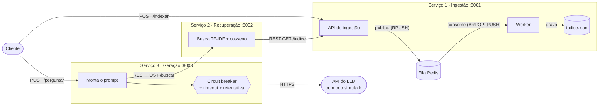

# C2.A2 — RAG Distribuído em Microsserviços

Sistemas Distribuídos e Computação em Nuvem · FAESA · 2026/2 · Turma 8HC1

## Integrantes

- Arthur Coutinho Chagas
- Enzo Sampaio Lopes Herzog de Azeredo
- Luan Gonçalves dos Santos
- Lucas Machado de Magalhães
- Vinícius de Souza Silva

## O que é

Sistema de perguntas e respostas com **RAG** (geração aumentada por recuperação)
sobre um conjunto de documentos, decomposto em **três microsserviços
independentes**. Uma pergunta entra e uma resposta **fundamentada nos documentos**
sai, citando de quais documentos ela veio. A chamada ao LLM (dependência externa
lenta e instável) é protegida por **circuit breaker, tempo-limite e retentativa**.

Sem chave de API o sistema roda em **modo simulado** (100% offline).

## Arquitetura



Fluxo ponta a ponta:

1. **Indexação (assíncrona):** o cliente envia documentos para `POST /indexar`
   (ingestão). A API só **enfileira** no Redis e responde `202` na hora; o
   **worker** consome a fila e persiste os documentos no índice.
2. **Pergunta:** o cliente chama `POST /perguntar` (geração). A geração pede os
   trechos mais relevantes à recuperação por **REST**, que busca o índice na
   ingestão (REST) e ranqueia por similaridade do cosseno (TF-IDF).
3. **Geração:** a geração monta o prompt com os trechos e chama o LLM **através
   do circuit breaker**. A resposta volta com o texto, o contexto usado e as
   **fontes** (documento de origem e similaridade).

### Os três serviços

| Serviço | Porta | Responsabilidade | Fala com |
|---|---|---|---|
| **Ingestão** (`servicos/ingestao`) | 8001 | Recebe documentos, enfileira (API) e indexa (worker) | Redis (fila); expõe `GET /indice` por REST |
| **Recuperação** (`servicos/recuperacao`) | 8002 | Dada uma pergunta, devolve os top-k trechos mais similares | Ingestão (REST) |
| **Geração** (`servicos/geracao`) | 8003 | Monta o prompt e chama o LLM com proteção | Recuperação (REST); LLM (HTTPS) |

Cada serviço é um processo/contêiner próprio, com API própria; um só conhece os
outros pela URL (`URL_INGESTAO`, `URL_RECUPERACAO`). `servicos/comum` guarda só
código compartilhado (embeddings, cliente de LLM, circuit breaker).

### Comunicação

- **REST** entre serviços: geração → recuperação → ingestão.
- **Mensageria (fila Redis)** na etapa de ingestão: a API publica com `RPUSH`; o
  worker consome com `BRPOPLPUSH` para uma fila `processando` e só remove a
  mensagem depois de gravar o índice (se o worker cair no meio, a mensagem
  continua guardada na fila `processando`, em vez de ser perdida). O cliente
  nunca espera a indexação.

### Resiliência da chamada ao LLM (`servicos/geracao/app.py`)

| Mecanismo | Como funciona | Configuração (padrão) |
|---|---|---|
| **Tempo-limite** | Cada tentativa tem timeout; se o LLM não responde, conta como falha | `LLM_TIMEOUT=20` s |
| **Retentativa** | Até 3 tentativas com *backoff* exponencial (0,5 s, 1 s) | `LLM_TENTATIVAS=3`, `LLM_BACKOFF_SEGUNDOS=0.5` |
| **Circuit breaker** | Após 5 falhas seguidas o circuito **abre** e recusa chamadas na hora (sem esperar timeout nem sobrecarregar o LLM). Depois de 20 s fica *meio-aberto*: deixa passar uma chamada de teste; se der certo, **fecha** | `CB_LIMITE_FALHAS=5`, `CB_ESPERA_SEGUNDOS=20` |

Cada tentativa passa pelo disjuntor; se ele já está aberto, **não há
retentativa**. Se o LLM não responde, o sistema **degrada com elegância**: devolve
`503` com mensagem clara **e os trechos recuperados** (`contexto` e `fontes`), em
vez de quebrar. Se a recuperação/ingestão estiver fora do ar, a geração também
responde `503` (e não `500`). O estado do circuito aparece em `GET :8003/saude`.

## Como executar do zero

Pré-requisito: **Docker** com Docker Compose. Não precisa de chave de API nem de
internet.

```bash
git clone https://github.com/ensosampaio/sd-2026-2-kit-c2a2.git
cd sd-2026-2-kit-c2a2

docker compose up --build -d      # sobe redis, ingestao, worker, recuperacao e geracao
```

Indexe os documentos de teste (`documentos/*.txt`) e faça uma pergunta. Os
scripts só precisam de Python com `requests` (`pip install requests`); se
preferir, use os `curl` abaixo.

```bash
python scripts/indexar_documentos.py
python scripts/perguntar.py "o que diz o teorema CAP?"
```

Equivalente com `curl`:

```bash
curl -X POST http://localhost:8001/indexar -H "Content-Type: application/json" \
  -d '[{"texto":"O teorema CAP trata de consistencia e disponibilidade.","origem":"aula11"}]'

curl -X POST http://localhost:8003/perguntar -H "Content-Type: application/json" \
  -d '{"pergunta":"o que diz o teorema CAP?"}'
```

Resposta (modo simulado):

```json
{
  "pergunta": "o que diz o teorema CAP?",
  "resposta": "[MODO SIMULADO - sem LLM_API_KEY configurada] ...",
  "contexto": ["O teorema CAP afirma que, diante de uma particao de rede, ..."],
  "fontes": [{"origem": "teorema_cap.txt", "similaridade": 0.3047}]
}
```

Para parar: `docker compose down` (use `-v` para apagar também o índice).

### Executando sem Docker (desenvolvimento)

Só o Redis precisa de contêiner; os serviços rodam no venv, cada um em um terminal.

```bash
python -m venv .venv
# Windows: .venv\Scripts\activate      Linux/macOS: source .venv/bin/activate
pip install -r requirements.txt

docker compose up -d redis

uvicorn servicos.ingestao.app:app    --port 8001
python -m servicos.ingestao.worker
uvicorn servicos.recuperacao.app:app --port 8002
uvicorn servicos.geracao.app:app     --port 8003
```

### Usando um LLM real

A chave **nunca** vai no código. Copie `.env.example` para `.env` (ele está no
`.gitignore`), preencha `LLM_API_KEY` (e, se quiser, `LLM_API_URL`/`LLM_MODELO`) e
suba de novo: `docker compose up -d --force-recreate geracao`. Sem
Docker: `uvicorn servicos.geracao.app:app --port 8003 --env-file .env`.

## Testando a resiliência

Para ver o circuito abrir **sem depender de internet**, simule um LLM
inalcançável: no `.env` coloque `LLM_API_KEY=qualquer-coisa` e
`LLM_API_URL=http://127.0.0.1:1/v1`, e recrie a geração
(`docker compose up -d --force-recreate geracao`). Depois:

```bash
python scripts/perguntar.py "o que e falha parcial?"   # 1a: 3 tentativas -> 503
python scripts/perguntar.py "o que e falha parcial?"   # 2a: abre o circuito na 5a falha -> 503
python scripts/perguntar.py "o que e falha parcial?"   # 3a: 503 imediato, sem chamar o LLM
curl http://localhost:8003/saude                       # {"status":"ok","disjuntor":"aberto"}
```

Após `CB_ESPERA_SEGUNDOS` o circuito fica meio-aberto e volta a testar o LLM. Também
é possível derrubar a recuperação (`docker compose stop recuperacao`) e ver a
geração responder `503` em vez de quebrar.

## Estrutura

```
├── servicos/
│   ├── comum/            # embeddings (TF-IDF), cliente de LLM, circuit breaker
│   ├── ingestao/         # app.py (API + fila) e worker.py (consumidor)
│   ├── recuperacao/      # app.py (busca por similaridade)
│   └── geracao/          # app.py (prompt + LLM protegido)
├── documentos/           # base de teste para indexar
├── scripts/              # indexar_documentos.py, perguntar.py
├── Dockerfile
├── docker-compose.yml    # redis + 3 serviços + worker
└── .env.example
```

## Decisões de projeto

- **Fila só na ingestão:** indexar é a etapa lenta e que o cliente não precisa
  esperar; a pergunta, ao contrário, precisa de resposta síncrona.
- **Índice em arquivo JSON** (volume `dados` no Docker), compartilhado entre API e
  worker de ingestão; a recuperação o lê via REST, sem acessar o arquivo
  diretamente. Reindexar o mesmo documento não duplica o índice.
- **Embeddings TF-IDF** (kit): offline, sem download. Recalculados a cada busca
  sobre o índice atual, o que dispensa persistir vetores para este volume de dados.
- **Sofisticação do modelo não conta nota:** o foco está na decomposição, na
  comunicação e na proteção do LLM.
